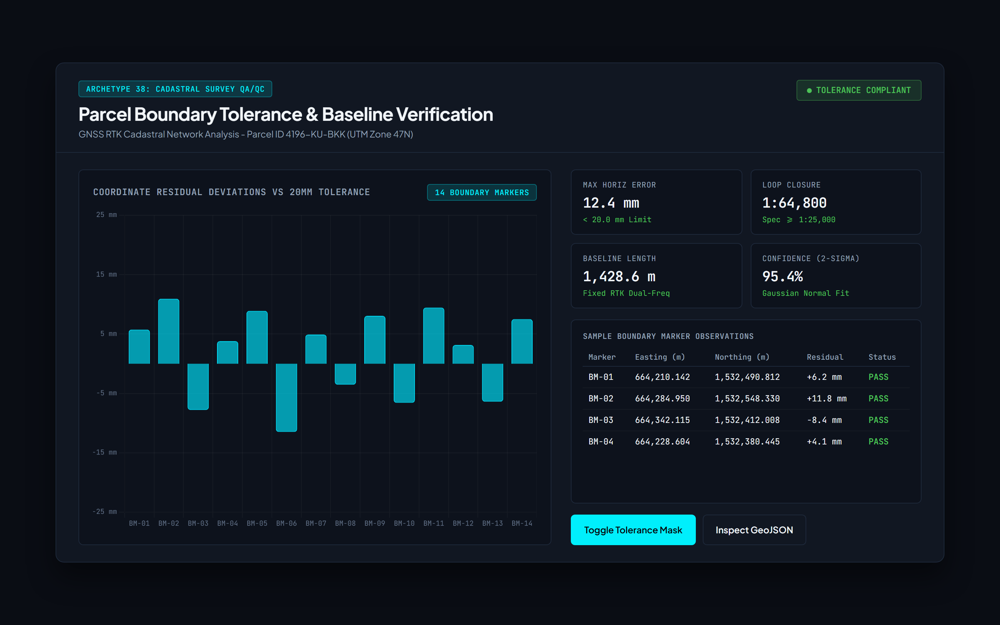
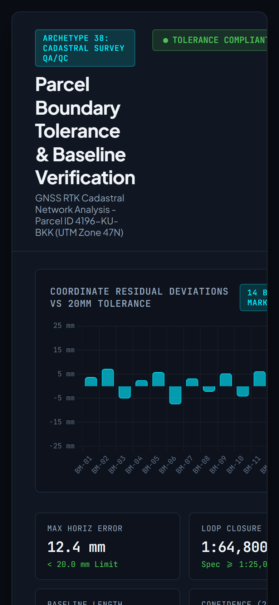
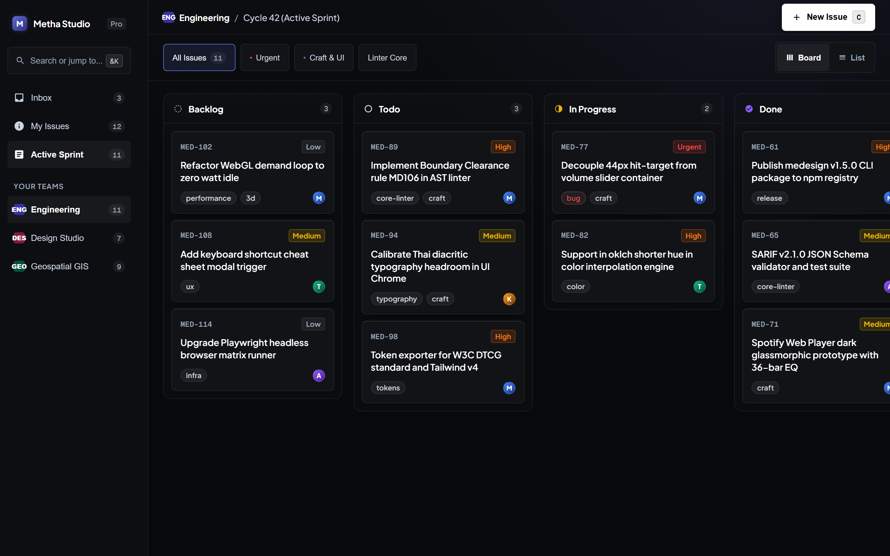
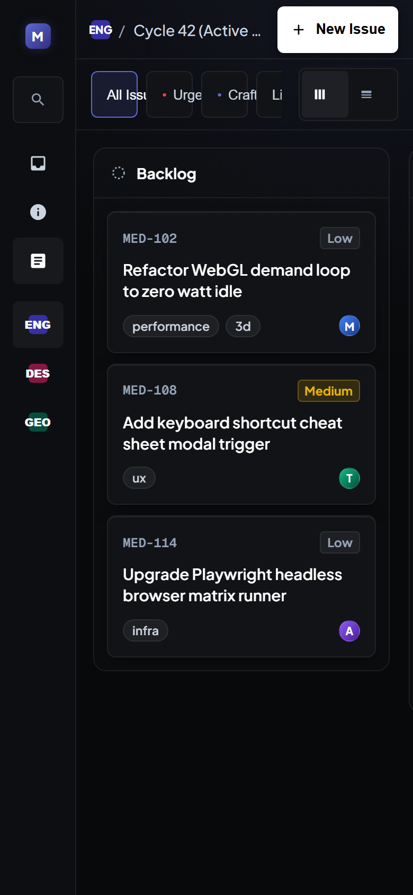
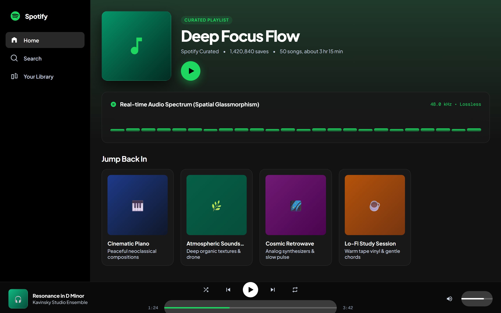
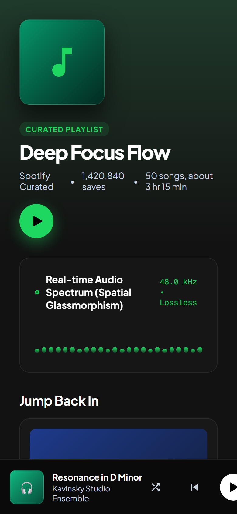
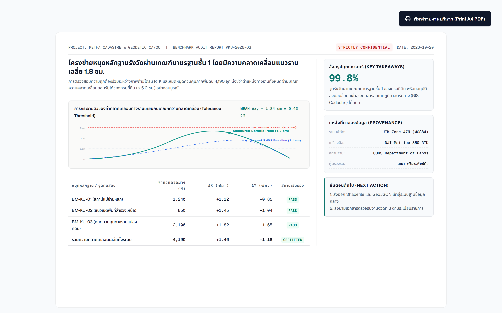
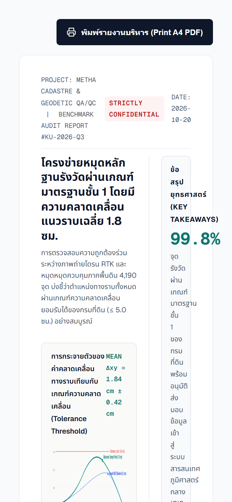

# ME-DESIGN v1.6.1

**The Autonomous Design Engineering System, Deterministic Quality Linter & Auto-Compiler for AI Coding Assistants**

[](https://opensource.org/licenses/MIT)
[](https://github.com/methastrategy/medesign/actions/workflows/ci.yml)
[](https://www.npmjs.com/package/medesign)
[](https://nodejs.org/)
[]()
[]()
[]()

*Eliminate AI Slop and bring optical mathematics, perceptual color science, and mission-critical engineering rigor to automated UI/UX generation.*

---

## 🌟 Why ME-DESIGN?

Most AI-generated user interfaces suffer from **Decisionless Uniformity**: generic 3-card grids, oversaturated neon glows, clipping Thai/Latin font metrics, broken keyboard accessibility, and non-proportional press deformations.

**ME-DESIGN** changes the paradigm from subjective aesthetic prompting to an **executable 5-Engine Design Architecture** coupled with a **Dual-Tier Quality Linter**, **Knowledge Discovery Search Engine**, **Self-Healing Code Repair**, **Interactive Brief Intake Gate (v2.3)**, and **74 Global Brand Multi-Pane Systems**.

---

## 🖼️ Visual Showcase & Responsive Render Gallery

Pre-rendered directly by ME-DESIGN's Headless Chrome CDP Engine across Desktop (1440×900) and Mobile (390×844) viewports:

| Design System & Archetype | Desktop View (1440×900) | Mobile View (390×844) |
| :--- | :--- | :--- |
| **Cadastral Engineering QA/QC**<br>*(Archetype 38 — Geospatial Precision)* |  |  |
| **Linear Issue Board**<br>*(Archetype 06 — Linear Minimal & High-Density)* |  |  |
| **Spotify Web Player**<br>*(Archetype 21 — Decoupled 3-Pane Media Studio)* |  |  |
| **Executive Saliency Report**<br>*(Archetype 02 — Swiss International Editorial)* |  |  |

---

## ⚔️ Multi-Dimensional Competitive Benchmark

| Dimension | `medesign` (v1.6.0) | `ui-ux-pro-max-skill` | `pbakaus/impeccable` |
| :--- | :--- | :--- | :--- |
| **Execution Architecture** | **Autonomous Node.js CLI & Deterministic Engine** | Prompt-only System Text | Markdown Guidelines & Rules |
| **Brief Intake Protocol** | **Dual-Layer Auto-Intent Routing & 1-Click Cockpit Gate** | Free-form Prompting | Manual Instructions |
| **Verification Gate** | **Mathematical Q-Score (0–100) + Hard Invariants** | Subjective LLM Self-Critique | Manual Inspection Checklist |
| **Self-Healing Code Repair** | **Deterministic Pattern & Style Fixer (`medesign polish`)** | Re-prompting Prompt Loop | Manual Code Editing |
| **Conversational Modifiers** | **Instant Code Density (`bolder` / `quiet`)** | Chat Revision Re-rolls | None |
| **Knowledge Discovery** | **Pure Node.js Search across 38 Archetypes & 74 Brands** | Static Markdown Reading | Static Document Browsing |
| **Automated CI/CD Quality Gate** | **Native OASIS SARIF v2.1.0 for GitHub Code Scanning** | None | None |
| **Perceptual Color Science** | **OKLCH / OKLab Gamut Mapping & `color-mix()`** | Standard Hex / sRGB Defaults | Hex / sRGB Recommendations |
| **Headless Browser Matrix** | **Chrome DevTools Protocol (Real Contrast & 44px Hit-Targets)** | None | Manual Browser DevTools |
| **Design Token Standards** | **Tailwind v4 `@theme`, W3C DTCG & CSS Custom Properties** | Unstructured CSS Snippets | None |
| **Domain Archetype Depth** | **38 Decoupled Archetypes + 74 Brand Systems (HMI, GIS, Audio)** | Generic SaaS / E-commerce | General UI Polish Rules |
| **Runtime Package Footprint** | **Zero-Dependency CLI & Comprehensive Ruleset on npm** | Multi-file Prompt Repos | Docs / Repo Only |

---

## 🏛️ The 5-Engine Core Architecture

```
ME-DESIGN Core Engine
├── 01. Optical Geometry Engine      -> Safe Concentric Radii, Area-Proportional Scaling, Hit Target Isolation
├── 02. Perceptual Color Engine      -> OKLCH / OKLab Gamut, Dynamic color-mix(), Dark Mode Functional Tokens
├── 03. Motion & Interaction Engine  -> 4 Behavioral Profiles (precision, soft-settle, spring-settle, instant)
├── 04. Typography & Script Engine   -> Dual-Context Line-Height, Thai Diacritic Clearance, @font-face Calibration
└── 05. Quality & Saliency Auditor   -> 4-Tier Governance, Task-Driven Attention Models, Zero-Compromise Gate
```

---

## 📐 38 Production Archetypes & 74 Global Brand Systems

ME-DESIGN decouples UI synthesis across 5 independent axes:
**Operational Archetype × Visual Language × Spatial Model × Motion Profile × Governance Tier**

- **Group A: Luxury & Editorial (01-05):** Quiet Luxury, Swiss International Editorial, Dark Haute Couture...
- **Group B: SaaS, DevTools & High-Density (06-12):** Linear Minimal, Vercel Clean Monochrome, Bloomberg Pro Density, Raycast Spatial HUD...
- **Group C: Fintech, Crypto & Glassmorphism (13-18):** Stripe Clean Gradient, Cyberpunk Matrix, Cosmos Acrylic Glass...
- **Group D: Modern Consumer, E-Commerce & Brand (19-24):** Apple Pro Spatial, Airbnb Warm Domestic...
- **Group E: Creative Agency & Experimental (25-30):** Neo-Brutalism, Kinetic Marquee, Biophilic Wellness...
- **Group F: Mission-Critical Engineering & HMI (31-38):**
  - **31. Mission Control HMI (ISA-101 Standard):** Tri-state alarms, greyscale base, operator decision priority.
  - **32. Geospatial Situation Awareness (GIS & Cadastre):** Map-centric 16:10 / 100dvh, linked selection tables, EPSG coordinates.
  - **33. CAD Precision Workbench:** Maximized canvas, floating command bar, geometric snap indicators.
- **74 Global Brand Multi-Pane Systems:** Pre-calibrated spatial layouts and design tokens for premier brands (Apple, Spotify, Linear, Tesla, Stripe, Bloomberg, GitHub, Vercel, Porsche, Teenage Engineering, etc.).

---

## 📦 Installation & Global CLI

Install globally or execute instantly with `npx`:

```bash
# Direct execution without permanent installation
npx medesign <command>

# Or install globally
npm install -g medesign
```

### Verified CLI Commands

```text
ME-DESIGN CLI v1.6.1
Autonomous Design Engineering Toolkit & Automated Linter for AI Coding Assistants

USAGE:
  medesign <command> [options]

COMMANDS:
  search <query>         Search 38 Archetypes & presets with discovery engine
                        Options: --json

  polish <file>          Self-healing repair for Hard Invariants (MD005, MD104, em-dash)
                        Options: --dry-run

  bolder <file>          Boost visual density, font weights, and border contrast

  quiet <file>           Softens visual density, font weights, and border treatments

  lint <file>            Lint HTML/CSS/JSX file with deterministic pattern & architectural rules
                        Options: --format <text|json|sarif>
                                 --preset <apple|tesla|metha>
                                 --config <path>

  audit <file>           Run headless Chrome DevTools Protocol verification matrix
                        (Checks computed contrast, tab focus outline, 44px hit-targets across viewports)
                        Options: --json

  snapshot <file>        Capture high-DPI rendered screenshots across responsive viewports
                        Options: --out <dir>, --og (1200x630 banner), --viewports <list>

  tokens [export]        Export preset design tokens to Tailwind v4 @theme, W3C DTCG, or CSS
                        Options: --preset <apple|tesla|metha|all>
                                 --format <tailwind|dtcg|css|all>
                                 --out <directory>

  presets [list|get]     Inspect available design system presets
                        Usage: medesign presets list
                               medesign presets get <preset-name>

  test [options]         Run deterministic test suite across fixtures
                        Options: --browser (runs both static pattern and headless browser matrix)

  doctor                 Verify local environment, Node.js, and Chrome/CDP availability

  help                   Display this help message
```

---

## 🛠️ Automated Quality Linter & Self-Healing Repair

### 🛡️ Deterministic Static Rules Linter (`medesign lint`)

```bash
# Output human-readable terminal report
npx medesign lint path/to/dashboard.html

# Output SARIF 2.1.0 JSON format for GitHub Code Scanning
npx medesign lint path/to/dashboard.html --format sarif > medesign-results.sarif
```

### 🩹 Self-Healing Repair (`medesign polish`)

Automatically inspects and repairs hard invariants directly in code:
- **MD104:** Replaces raw unconstrained `100vh` with safe modern `100dvh` fallbacks.
- **MD005:** Replaces `outline: none` with physical `:focus-visible` rings and `@media (forced-colors: active)`.
- **MD002:** Adds `@media (prefers-reduced-motion)` accessibility gates.
- **MD201:** Cleans up decorative AI-tell em-dashes `—` (including entity `&mdash;`) into clean hyphens `-`.

```bash
npx medesign polish path/to/dashboard.html
```

```text
[POLISH COMPLETED] 3 issues automatically repaired in dashboard.html
  Fixed: Replaced 1 raw 100vh with 100dvh fallback (MD104)
  Fixed: Added physical focus outline & forced-colors high contrast (MD005)
  Fixed: Cleaned 2 AI-tell em-dash punctuation & entities
Q-Score: 91.3 -> 95.0 [PASS]
```

### ⚡ Visual Density Modifiers (`medesign bolder` & `medesign quiet`)

Adjust visual weight, border contrast, and color vibrancy directly in your files:

```bash
# Elevate font weights (normal -> medium -> semibold -> bold), deepen border contrast, and boost OKLCH/Tailwind accent saturation
npx medesign bolder path/to/dashboard.html

# Soften font weights, convert borders to subtle hairlines, and shift OKLCH/Tailwind colors to a restrained minimalist palette
npx medesign quiet path/to/dashboard.html
```

---

### The Terminal Quality Audit Card

```text
ME-DESIGN v1.6.0
Design Quality & Governance Audit
────────────────────────────────────────
Target        dashboard.tsx
Archetype     Geospatial Situation Awareness (32)
Analysis      Deterministic Static Pattern Rules
Ruleset       medesign-standard@1.6.0

QUALITY SCORE (Q = 0.30H + 0.25I + 0.20G + 0.15R + 0.10V)
  Hierarchy (H)       94.0 / 100
  Information (I)     90.0 / 100
  Geometry (G)        92.0 / 100
  Responsive (R)      88.0 / 100
  Visual Craft (V)    95.0 / 100

  Q-SCORE             91.8 / 100  [PASS]

HARD INVARIANTS CHECKLIST
  PASS  Keyboard Focus Ring Visibility (:focus-visible)
  PASS  Reduced Motion Compliance (@media prefers-reduced-motion)
  PASS  Anti-AI Tells: Zero Em-Dash Invariant
  PASS  Predictable DOM Order (No unsemantic dense flow)

────────────────────────────────────────
RESULT: PASS (Exit Code: 0)
```

---

## 🤖 AI Coding Assistant Integrations

ME-DESIGN provides shared rule adapters for all major agentic tools:

- **Google Antigravity:** Native Skill supported under `skills/medesign/SKILL.md`
- **Claude Code:** Copy `integrations/claude-code/SKILL.md` to `.claude/skills/medesign/SKILL.md`
- **Cursor:** Copy `integrations/cursor/medesign.mdc` to `.cursor/rules/medesign.mdc`

---

## 📄 License

MIT License © 2026 Metha Triparamkit (Survey Engineering & Geoinformatics, Kasetsart University).
