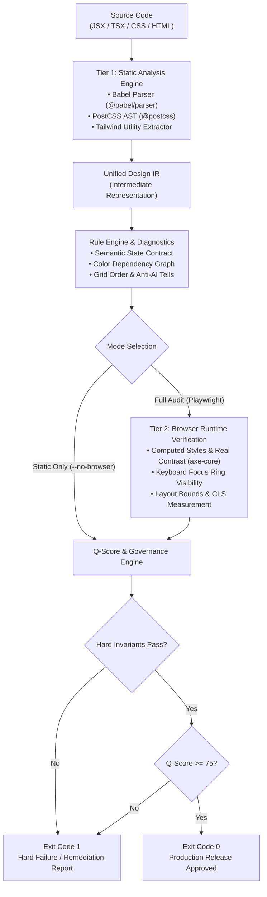

# ME-DESIGN CLI & Linter Architecture Specification (ADR-001)

สถาปัตยกรรมเครื่องมือ Static Analysis + Browser Verification สำหรับ `medesign-cli` เพื่อการพัฒนาและเผยแพร่เป็น Open-Source บน GitHub และ npm

---

## 1. Dual-Tier Verification Pipeline

การตรวจคุณภาพ UI/UX ระดับวิศวกรรมต้องแยกชั้นการวิเคราะห์อย่างชัดเจน เพื่อป้องกัน False Positives จากการเดาสไตล์ที่ยังไม่ได้เรนเดอร์:



---

## 2. Unified Design IR (Intermediate Representation)

ข้อมูลทุกชนิดจาก AST ต่างๆ จะถูก Normalization เข้าสู่โมเดลกลางเดียวกัน:

```typescript
export interface DesignElement {
  id: string;
  source: {
    file: string;
    line?: number;
    column?: number;
  };
  semanticRole?: string;
  tag: string;
  classNames: string[];
  inlineStyles?: Record<string, string>;
  expectedStates?: ('default' | 'hover' | 'pressed' | 'focus-visible' | 'disabled' | 'loading')[];
  rendered?: {
    bounds?: { x: number; y: number; width: number; height: number };
    computedStyles?: Record<string, string>;
    contrastRatio?: number;
    focusVisible?: boolean;
  };
}

export interface Diagnostic {
  ruleId: string;
  category: 'H' | 'I' | 'G' | 'R' | 'V';
  severity: 'error' | 'warning' | 'info';
  confidence: 'high' | 'medium' | 'low';
  hardInvariant: boolean;
  message: string;
  file: string;
  line?: number;
  column?: number;
  remediation?: string;
}
```

---

## 3. The 5-Category Q-Score Formulation

คำนวณคะแนนรวมคุณภาพผ่านสมการถ่วงน้ำหนัก:
$$Q = 0.30H + 0.25I + 0.20G + 0.15R + 0.10V$$

- **$H$ (Hierarchy & Task Saliency - 30%):** จุดโฟกัสสอดคล้องกับ Attention Model (Task-First, Spatial, Alert-First, Reading, F, Z)
- **$I$ (Information Architecture - 25%):** ความครบถ้วนของ State Handling (10-State Machine Matrix), แหล่งข้อมูล และการจัดกลุ่มข้อมูล
- **$G$ (Geometry & Coherence - 20%):** Concentric Border Radius, Hit Target $\ge 44\text{px}$, และ Aspect Ratio ของโมดูล
- **$R$ (Responsive Stability & CLS - 15%):** Reserved Geometry, Stable Data Regions, Breakpoint Flow (CLS $\approx 0$)
- **$V$ (Visual Craft & Anti-Slop - 10%):** การใช้ OKLCH/OKLab, Tinted Neutrals, Zero Em-Dash, Zero Decisionless Uniformity

### Zero-Compromise Gating Policy:
1. หากพบข้อผิดพลาดระดับ **Hard Invariant Failure** (แม้เพียงจุดเดียว) $\longrightarrow$ **Result: FAIL (Exit Code 1)** โดยไม่สนใจว่า $Q$-Score จะได้ 95+ หรือไม่
2. เกณฑ์คะแนน:
   - $90.0 - 100.0$: **PASS** (เกณฑ์ปล่อยสู่ Production)
   - $75.0 - 89.9$: **REVIEW REQUIRED** (Candidate ที่ต้องตรวจสอบคำเตือน)
   - $< 75.0$: **FAIL** (ปรับปรุงโครงสร้างก่อนส่งมอบ)

---

## 4. CLI Terminal Summary Card Specification

เมื่อรัน `npx medesign lint [path]` ระบบจะพิมพ์รายงานสรุปผลในรูปแบบ Compact Card:

```text
ME-DESIGN vNext
Design Quality Audit
────────────────────────────────────────

Project       src/
Archetype     Geospatial Situation Awareness (32)
Analysis      Static AST + PostCSS
Ruleset       medesign-standard@1.0.0

QUALITY SCORE
  Hierarchy (H)       94.0 / 100
  Information (I)     88.0 / 100
  Geometry (G)        92.0 / 100
  Responsive (R)      85.0 / 100
  Visual Craft (V)    90.0 / 100

  Q-SCORE             90.6 / 100  [PASS]

HARD INVARIANTS
  PASS  Dual-Theme Contrast (AAA/AA)
  PASS  Keyboard Focus Visibility (:focus-visible)
  PASS  Hit Target Isolation (>= 44px)
  PASS  Reduced Motion Compliance

FINDINGS
  0 hard invariant failures
  0 errors
  2 warnings

  warn   MD204  src/components/Table.tsx:42
         Consider using Named Grid Areas instead of implicit flow.

────────────────────────────────────────
RESULT: PASS (Exit Code: 0)
```

---

## 5. Monorepo & AI Agent Integration Blueprint

### โครงสร้างแพ็กเกจ (pnpm Monorepo):
- `packages/cli`: คำสั่ง CLI, Command Parser, Terminal Reporter (`dist/bin.js`)
- `packages/core`: Unified Design IR, Rule Contracts, Scoring Engine
- `packages/rules-standard`: กฎสากลสำหรับ Web App & Landing Page
- `packages/rules-engineering`: กฎสำหรับ GIS, CAD, Telemetry, HMI ISA-101

### Shared Rule Registry สำหรับ AI Coding Assistants:
- **Claude Code:** `.claude/skills/medesign-audit/SKILL.md`
- **Cursor:** `.cursor/rules/medesign.mdc`
- **Antigravity:** `.agents/skills/medesign/SKILL.md`
