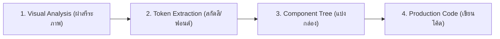

# Image-to-Code Implementation Pipeline

กระบวนการแปลงภาพต้นแบบหรือ Mockup ให้กลายเป็นโค้ดส่วนติดต่อผู้ใช้ (Frontend Code) คุณภาพสูง มีความเที่ยงตรง (High Fidelity) และสอดคล้องกับมาตรฐานทางวิศวกรรม

---

## 1. วงจรการแปลง 4 ขั้นตอน (4-Stage Conversion Flow)

---

## 2. รายละเอียดขั้นตอนการปฏิบัติงาน

### ขั้นที่ 1: การวิเคราะห์ภาพเชิงลึก (Deep Visual Decomposition)
- **Spatial Grid:** ระบุจำนวนคอลัมน์, Max Width, และระยะห่าง (Gap, Margin, Padding)
- **Visual Hierarchy:** แยกแยะลำดับสายตา (Display Title $\rightarrow$ Subtitle $\rightarrow$ Primary CTA $\rightarrow$ Secondary Metadata)
- **Surface & Elevation:** ตรวจสอบความทึบของพื้นผิว (Solid, Frosted Glass `backdrop-blur`, Border Radius, Drop Shadows)

### ขั้นที่ 2: การสกัด Token และประสานกับ User DNA
- แมปคู่สีที่พบในภาพเข้ากับ Palette ใน `user-profile.json` หรือ [design-core.md](design-core.md)
- แปลงค่าสีให้เป็นตัวแปร Tailwind หรือ CSS Variables (เช่น `bg-background`, `border-border`, `text-foreground`)
- เลือกใช้คู่ฟอนต์ตามระบบ: Heading (Serif หรือ Display มีสไตล์) + Body (Clean Sans) + Monospace สำหรับตัวเลข

### ขั้นที่ 3: การแตกชิ้นส่วน Component (Modular Tree)
- แบ่งโค้ดออกเป็นชิ้นส่วนย่อย (เช่น `Navbar`, `HeroSection`, `BentoGrid`, `MetricCard`, `Footer`)
- กำหนด Property และ State ที่จำเป็น (เช่น Hover effects, Active states, Responsive breakpoints)

### ขั้นที่ 4: การลงมือเขียนโค้ดจริง (High-Fidelity Implementation)
- **HTML Semantics:** ใช้แท็กที่มีความหมาย (`<header>`, `<main>`, `<section>`, `<article>`, `<nav>`)
- **Responsive Layout:** พัฒนาแบบ Mobile-First พร้อมขยายเป็น Grid/Flex บน `md:` และ `lg:`
- **Micro-Interactions:** เติมลูกเล่นเบาๆ เช่น `transition-all duration-150`, `hover:border-white/20`, `active:scale-[0.98]`
- **Data Hardening:** ใช้ข้อมูลจำลองที่สมจริง (Realistic Mock Data) ห้ามใช้ข้อความขยะ

---

## 3. เกณฑ์การตรวจรับงานแปลงโค้ด (Fidelity Verification)
- [ ] สัดส่วนระยะห่าง (Whitespace) ตรงตามภาพต้นแบบ ไม่เบียดหรือแน่นเกินไป
- [ ] ค่าสีและ Contrast ผ่านเกณฑ์ WCAG AA สำหรับการอ่าน
- [ ] ปุ่ม Action ทุกปุ่มมี Hover / Active feedback
- [ ] โค้ดคอมไพล์ผ่าน 0 errors และไม่มี Dependency นอกเหนือจากที่โปรเจกต์รองรับ
