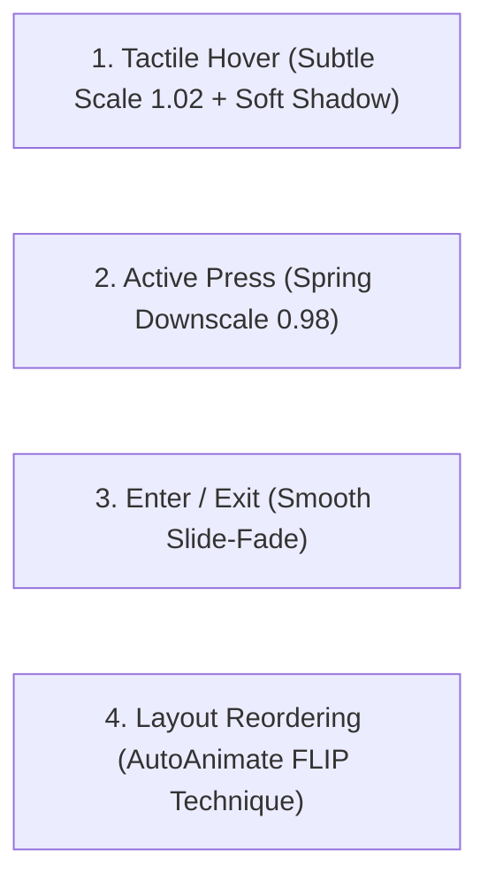

# Micro-Interactions & AutoAnimate Layout Protocol

ระเบียบวิธีการใส่ลูกเล่นการเคลื่อนไหว (Micro-Interactions) และการเปลี่ยนผ่านเลย์เอาต์ที่ลื่นไหลระดับสากล (ดัดแปลงจากโมเดลของ `FormKit AutoAnimate` และ `Framer Motion`) เพื่อยกระดับความรู้สึกพรีเมียม (Tactile Delight) ให้กับหน้าเว็บและแดชบอร์ด โดยไม่เพิ่มความซับซ้อนของโค้ดและรองรับ Accessibility 100%

---

## 1. ปัญหาของ UI ที่กระตุกกระด้าง (Stiff Layout Transitions)

การขาด Micro-Interactions ทำให้เว็บดูราคาถูกและแข็งกระด้าง:
1. **Sudden DOM Snapping**: เมื่อเพิ่มแถวตาราง ลบการ์ด หรือสลับ Tab หน้าจอจะกระตุกเปลี่ยนทันที ทำให้ผู้ใช้สูญเสียการรับรู้ตำแหน่ง (Spatial Context)
2. **Animation Bloat**: การเขียน CSS Animation เองทุกจุดก่อให้เกิดโค้ดซ้ำซ้อนและกระตุกบนอุปกรณ์สเปกต่ำ
3. **Motion Sickness**: ขาดการรองรับผู้ใช้ที่มีภาวะไวต่อการเคลื่อนไหว (`prefers-reduced-motion`)

---

## 2. พลังของ Zero-Config Drop-in Animation (AutoAnimate Pattern)

`@formkit/auto-animate` มอบการเคลื่อนไหวระดับสตูดิโอให้ทุกจุดใน DOM ด้วยโค้ดเพียงบรรทัดเดียว:

```typescript
import { useAutoAnimate } from '@formkit/auto-animate/react';

export function OrderList({ orders }) {
  // บังคับการเคลื่อนไหวที่ลื่นไหลทันทีที่มีการ Add/Remove/Sort รายการ
  const [parentRef] = useAutoAnimate({ duration: 250, easing: 'ease-out' });

  return (
    <div ref={parentRef} className="space-y-3">
      {orders.map(order => (
        <OrderCard key={order.id} order={order} />
      ))}
    </div>
  );
}
```

---

## 3. สถาปัตยกรรม Micro-Interactions 4 มิติ



### 1. Tactile Feedback on Buttons & Cards
- **Hover State**: ยกการ์ดลอยขึ้นเบาๆ (`transform: translateY(-2px)`, `box-shadow` นุ่มนวลขึ้น)
- **Active State**: ยุบตัวลงตามแรงกดเสมือนปุ่มจริง (`scale-98`)
- **Transitions**: ใช้ Spring Curve `cubic-bezier(0.16, 1, 0.3, 1)` (Apple/Linear standard)

### 2. Layout Morphing (FLIP Technique)
- เมื่อมีการ Reorder หรือ Filter ข้อมูล การ์ดต้องสไลด์ไปยังตำแหน่งใหม่อย่างต่อเนื่อง ไม่ใช่หายไปแล้วโผล่ใหม่

---

## 4. กฎเหล็กด้านการเข้าถึง (Accessibility Invariant)

ต้องมี Media Query ปิดการเคลื่อนไหวเมื่อผู้ใช้เปิดโหมดลดการเคลื่อนไหวเสมอ:
```css
@media (prefers-reduced-motion: reduce) {
  *, ::before, ::after {
    animation-duration: 0.01ms !important;
    animation-iteration-count: 1 !important;
    transition-duration: 0.01ms !important;
    scroll-behavior: auto !important;
  }
}
```
